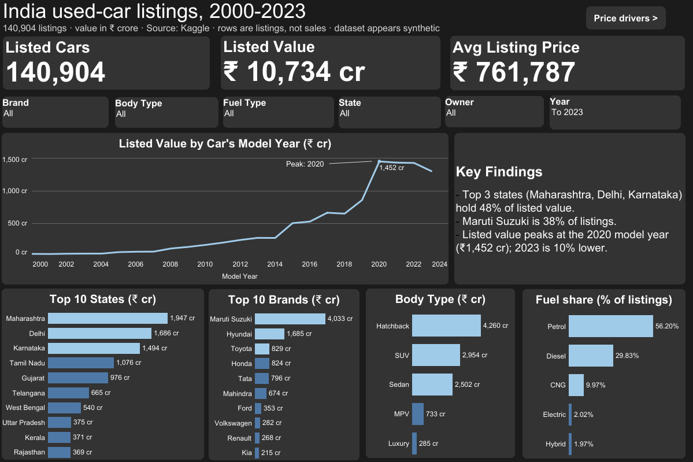

# Indian Used-Car Listings Dashboard (2000–2023)

**Live dashboard:** [Tableau Public]([https://public.tableau.com/app/profile/sagar.parmar2316/viz/IndiaUsed-CarListingsDashboard/Overview](https://public.tableau.com/views/IndiaUsed-CarListingsDashboard/Overview?:language=en-US&publish=yes&:sid=&:redirect=auth&:display_count=n&:origin=viz_share_link))

## Question
Which states, brands and car features drive the listed value of used cars, and how much do owner history and accident history change the price?

## Data
- Source: Kaggle, "Indian Car Sell Dataset" (https://www.kaggle.com/datasets/milapgohil/car-dataset)
- 140,904 rows, 12 columns. Each row is one car listing, not a confirmed sale. "Year" is the car's model year; there is no sale date.

## What I did
1. **Excel (data audit):** 15 checks on completeness, ranges and realism, plus 8 added columns (price in crore, car age with a fixed reference year of 2023, age/km/price bands, and 3 flags for impossible combinations). Results are in `excel/Data_Audit_Results.xlsx`.
2. **Tableau:** 2 dashboards (Overview and Price Drivers) with 5 KPI cards, 9 charts and 6 filters.

## Findings (in this dataset)
- Maharashtra, Delhi and Karnataka hold 48% of listed value.
- Maruti Suzuki accounts for 38% of listings.
- Listed value by model year peaks in 2020 (₹1,452 cr); 2023 is 10% lower.
- 1st-owner cars list at about 2.3x the price of 3rd+ owner cars (₹8.8L vs ₹3.9L).
- Cars with accident history list about 31% lower (₹5.4L vs ₹7.8L).
- Cars aged 0–3 years average ₹10.0L; cars aged 13+ years average ₹5.0L.

## Data quality (from the audit)
No blanks or duplicates, but: 586 electric cars with model years before 2013, 1,075 electric Maruti cars, 1,739 diesel Altos, kilometres unrelated to age (correlation 0.003), and near-equal counts for every Maruti model (5,902 to 6,157). The dataset is likely synthetic, so these results describe the dataset, not the real Indian market.

## Limitations
- Rows are listings, not sales, and there is no sale date, so there is no true "sales trend".
- Averages show association, not cause. Age and kilometres overlap.
- No reason is claimed for the 2020 peak.

## Files
`data/` raw and cleaned CSV · `excel/` audit results · `tableau/` workbook (opens in free Tableau Public Desktop) · `images/` dashboard screenshots

## Contact
Sagar Parmar · [LinkedIn](https://www.linkedin.com/in/sagar-parmar2025) · [Portfolio](https://sagarparmar.pages.dev)
